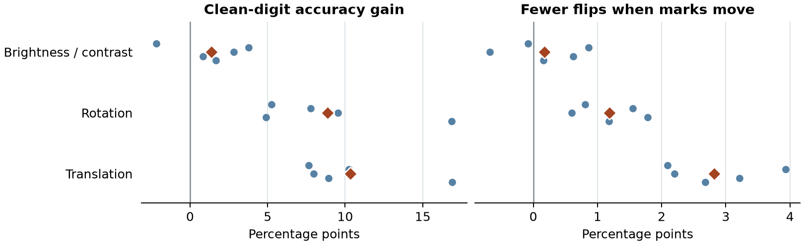
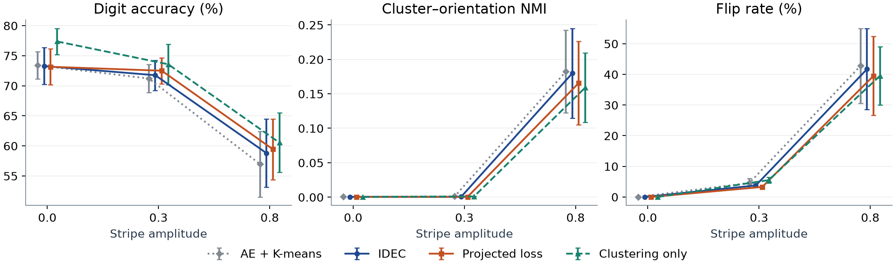

# IDEC final project

Our final model weights IDEC pretraining by an **adaptive-center Gaussian multiplied by each image's own cluster saliency**. Clean-trained students reach 71.59% on marked test digits, compared with 64.62% for ordinary IDEC and 71.51% for a fixed Gaussian with the same saliency. The five paired seed results and the three single-component ablations are collected in the [final experiment guide](final/README.md).

- [Run a fresh clean-only fit or regenerate the final tables](final/README.md)
- [Gaussian shape follow-up](gaussian_shape/README.md) with a second holdout, a rotated-ellipse control, and a whole-image position test
- [Component means](final/ablation.csv), [paired differences](final/paired.csv) and [per-seed scores](final/per_seed.csv)

- [Research report (PDF)](report/report.pdf) and [editable LaTeX](report/report.tex)
- [Presentation slides (PDF)](slides/slides.pdf) and [editable Beamer source](slides/slides.tex)
- [Reconstruction weighting on original MNIST](clean_neighborhood/design.md) and [paired results with ordinary and shuffled-weight IDEC](clean_neighborhood/results/summary.json)
- [Selecting reconstruction features from reproducible unlabeled clusters](cluster_features/README.md), [named stroke bins](cluster_features/coordinates/bins.csv), and [per-seed assignments and scores](cluster_features/results/runs.csv)
- [Matched DEC and IDEC protocol](dec_background/design.md), [method means](dec_background/results/summary.csv), [five paired differences](dec_background/results/paired.csv), [contrasts and variability](dec_background/results/contrasts.json) and [individual runs](dec_background/results/runs.csv)
- [IDEC+ on all 70,000 clean MNIST images, plus USPS, KMNIST, Fashion-MNIST and grayscale CIFAR-10](external_benchmarks/README.md)
- [Whole-image translation addendum](dec_background/translation/design.md), [combined comparison including DEC and IDEC with translation](dec_background/translation/results/summary.csv) and [per-seed augmentation effects](dec_background/translation/results/paired.csv)
- [Random background protocol](varied/design.md), [45-model results](varied/results/summary.csv), [paired comparisons](varied/results/paired.json) and [paired image examples](figures/varied.png)
- [Jitter protocol](photometric/design.md), [spatial protocol](photometric/spatial_design.md), [60-model results](photometric/analysis/summary.csv) and [within-seed effects](photometric/analysis/paired.json)
- [Geometric experiment design](background/design.md), [paired digit examples](figures/geometry.png), [four-arm results](background/results/summary.csv), [paired differences](background/results/paired.json)
- [Historical stripe report source](report/stripe_study.tex) and [the previous published PDF](https://github.com/JohnR31N/cs126FinalProj/blob/idec-final-v1.4/IDEC/report/report.pdf)
- [Prespecified design](design.md), [hyperparameters](protocol.json), [paper reproduction](reference/result.json), [all model results](results/runs.csv), [paired seed effects](results/paired.json)
- [Analysis and verification](analyze.py), [result checks](results/verification.json)
- [Training-stage follow-up design](stage/design.md), [the four final conditions and two initializations](stage/results/summary.csv), [within-seed effects](stage/results/paired.json)

## Earlier matched DEC and IDEC experiment

The [supplementary position experiment](position_alignment/README.md) examines the location sensitivity of frozen students on displaced test images. The main Gaussian reconstruction study and its ablations are linked above.

Each method trains on clean digits and on the same digits with two fixed background symbols. The 73.23% clean IDEC control uses fresh 100-epoch pretraining on 12,000 digits, 5,600 updates and scoring on 10,000 held-out digits, averaged over five seeds. The 88.10% reference starts from author weights and fits and scores all 70,000 digits, with 20,000 updates at seed 0. Both background conditions use the same five seeds and train/test indices. The drop for a seed is clean-trained/clean-tested ACC minus marked-trained/marked-tested ACC, in percentage points. Subtracting DEC's drop from IDEC's drop compares sensitivity to these backgrounds.

Standard DEC uses an autoencoder for initialization. We fork the same pretrained weights and K-means centers in each domain, then compare a clustering KL loss alone (DEC) with the same KL plus uniform pixel MSE (IDEC). The Gaussian variant uses a fixed map centered at (13.5, 13.5), with a width of seven pixels and mean weight one. Test it in both stages, in pretraining only, and in fine-tuning only. The separate KL-only random-start control skips all reconstruction, including the pretraining updates. See the [method and loss table](dec_background/results/table.tex) and [seed plot](figures/dec_background_drops.png).

| Method | Clean ACC | Marked ACC | Mean drop ± seed SD (points) |
|---|---:|---:|---:|
| DEC | 77.63% | 70.86% | 6.77 ± 5.40 |
| IDEC | 73.23% | 65.14% | 8.09 ± 5.01 |
| DEC with whole-image translation | 81.36% | 77.18% | 4.17 ± 4.04 |
| IDEC with whole-image translation | 83.88% | 77.61% | 6.27 ± 2.74 |
| Gaussian in both stages | 70.03% | 65.59% | 4.44 ± 3.98 |
| Gaussian in pretraining only | 74.07% | 68.80% | 5.27 ± 4.64 |
| Gaussian in fine-tuning only | 69.27% | 62.88% | 6.39 ± 5.18 |
| KL only from random weights | 31.00% | 28.90% | 2.10 ± 1.75 |

The IDEC-minus-DEC differences in loss were +2.78, −3.88, +1.77, +5.22 and +0.71 points (mean +1.32 ± 3.35). The shared uniform autoencoder already lost 5.20 points before either method fine-tuned it. On frozen clean-trained models, adding the symbols only at test time cost 2.01 points for DEC and 8.62 for IDEC.

Translation is a general augmentation control. IDEC gained 10.65 points on clean digits and 12.47 on marked digits, both positive in all five seeds. Its clean-to-marked drop shrank by 1.82 ± 3.70 points, with three reductions and two increases. Its redraw flips fell from 2.99% to 1.78% and its decoder response fell from 0.00843 to 0.00671, both lower in all five seeds. DEC gained 3.73 points clean and 6.33 marked. Among translated methods, IDEC's background drop exceeded DEC's by 2.10 ± 1.47 points in the same direction in every seed. The frozen clean-trained models lost 2.65 points for translated DEC and 7.62 for translated IDEC when symbols were first added at test time.

The primary two-stage Gaussian narrowed the clean-to-marked drop by 3.65 ± 5.43 points. It gained 0.45 points on marked digits (three of five seeds) but lost 3.20 points on clean digits (all five). Redraw flips fell from 2.99% to 2.63% and decoder response from 0.00843 to 0.00529, both down in every seed. The pretraining-only variant improved marked accuracy by 3.66 ± 4.74 points (four of five) and clean accuracy by 0.84 on average. The random-start KL control collapsed to a single cluster in both domains in seed 4.

## Random attributes and reconstruction targets

The 45-run follow-up uses two symbols per image drawn from 96 shape, size, angle and brightness combinations. It keeps all handwriting and a one-pixel guard band intact. A fixed-form circular control has the same per-symbol squared energy as each varied symbol. Training and test inputs follow the same background distribution, and every model sees two independently redrawn backgrounds on each held-out digit.

Ordinary IDEC reached 73.96% with clean training and testing, 65.74% on fixed-form backgrounds and 65.40% on varied backgrounds. The varied-minus-clean decline was 8.57 +/- 3.93 percentage points, and occurred in all five seeds. Reconstructing the known clean digit from the identical marked inputs raised accuracy to 71.44%, a paired gain of 6.04 +/- 4.37 points in all five seeds. Redraw flips fell from 2.98% to 2.35%, and the decoder response to the changed background fell from 0.00828 to 0.00145.

Changing just the pretraining target reached 70.62% accuracy, compared with 66.85% when changing only the fine-tuning target. Translation with ordinary reconstruction reached 77.63%, compared with 69.16% for Gaussian pretraining. The clean-target comparison uses privileged clean images as a diagnostic. The matched-energy fixed-form versus varied contrast was small and inconsistent across seeds. These results support a drawback of reconstructing irrelevant backgrounds in this setting, with the larger target effect entering during pretraining.

## Whole-image augmentation versus Gaussian weighting

Random whole-image translation gave the best standalone result on the fixed marked training set. Marked accuracy reached 80.63% and movement flips fell to 3.41%, compared with 67.51% and 6.23% for ordinary IDEC. The Gaussian-only arm reached 71.42% and 5.19%. All five paired seeds favored translation over Gaussian on marked accuracy and movement and shape flips. Adding the Gaussian to translation gave 79.93% accuracy and 3.66% movement flips.

With no mark anywhere in training or testing, translation also raised clean accuracy from 73.53% to 83.87%. When these clean-trained models first saw the marks at test time, movement flips were 11.69% with translation and 10.50% for the baseline. Among methods trained on marked images, the standalone linear shape probes scored between 50.13% and 50.26% (chance 50%). The controlled comparisons distinguish accuracy gains from assignment stability. They do not establish that the embedding discards all background information.



## Earlier targeted background augmentation

Moving a nine-pixel mark changed 6.20% of cluster assignments under ordinary IDEC, even though all handwriting stayed identical. Background augmentation reduced this to 4.34%, with a reduction in each of the five seeds. The paired reconstruction target reduced the decoder's mean response to the movement from 0.00313 under augmentation alone to 0.00085 (one represents perfect tracking). It brought movement flips to 4.18% but increased shape flips from 3.43% to 3.59%. The Gaussian-weighted arm yielded the highest mean marked-image accuracy, 72.91% compared with 71.02% under augmentation alone. All four arms retained ten occupied test clusters.

## Earlier additive-overlay studies

At strong stripe amplitude, switching the orientation of an otherwise identical test digit changed its cluster **41.72%** of the time under standard IDEC and **39.50%** with projected fine-tuning. The reduction appeared in all five paired seeds. Digit accuracy rose from **58.79% to 59.43%** on average (four of five seeds). The shared initial AE + K-means already flipped on **42.79%** of images. The clustering-only ablation reached **60.54%** digit ACC.

In the follow-up, applying the same projection earlier had a larger effect. With projected fine-tuning fixed, changing pretraining lowered flip rate from **39.53% to 2.61%** (paired reduction **36.92 ± 12.54 percentage points**, five of five seeds). Mean digit ACC rose from **59.96% to 69.61%**, with one seed losing 1.88 points. All ten clusters were occupied. Full-pixel fine-tuning after projected pretraining gave **4.73%** flips. These are within-follow-up comparisons at amplitude 0.8 on the same split and known stripe templates.



## The two MNIST protocols

| | Reference reproduction | Controlled stripe study |
|---|---|---|
| Training data | All 70,000 MNIST images, as in the paper | Fixed 12,000-image subset of the original training split |
| Initialization | Author-released AE weights, K-means with 20 restarts, seed 0 | Plain AE pretrained for 100 epochs independently in each of 15 seed/amplitude pairs |
| Evaluation | Hungarian ACC and NMI on the same 70,000 images | Fit a cluster-to-digit mapping on training labels after optimization; evaluate on the original 10,000 test images |
| Optimization | Up to 20,000 updates; check 0.1% change every 140 steps | Exactly 5,600 updates per arm, no early stopping, five model seeds |
| Evidence | Paper 88.06% ACC and 0.8672 NMI; this run 88.10% and 0.8650 | 3 amplitudes × 5 seeds × (one shared AE + K-means initialization and three fine-tuning arms) |

The author-weight run reached the update cap. Its published numerical target is transductive. All stripe results use held-out evaluation and fresh initialization. Ordinary and projected reconstruction use identical input images. The projected objective needs the two stripe templates; individual orientation labels are used only to construct and evaluate the data.

The follow-up used the strong-stripe condition and the same five seeds. It crossed ordinary or projected pretraining with ordinary or projected fine-tuning. We reran all four cells and compared models trained within this follow-up. Each pair of fine-tuning runs starts from the same weights and K-means centers. Changing pretraining can change both the embedding and its K-means centers.

## Reproduction

Run from **this folder**. For the tested Windows setup use Python 3.12, PyTorch 2.11.0 with CUDA 12.8, and the pinned scientific packages in `requirements.txt`. The CPU path uses the same protocol and can take substantially longer. Hardware-dependent variation is possible. The recorded runs used a local RTX 5080.

```powershell
uv venv .venv --python 3.12
uv pip install --python .venv/Scripts/python.exe -r requirements.txt
uv pip install --python .venv/Scripts/python.exe torch==2.11.0 --index-url https://download.pytorch.org/whl/cu128
.venv/Scripts/python.exe -m pytest -q test_objectives.py test_geometry.py test_photometric.py test_varied.py test_dec_background.py test_clean_neighborhood.py test_cluster_features.py
```

For Linux/macOS use `.venv/bin/python`. A CPU-only PyTorch installation works with `--device cpu`. When working inside the original parent repository, its configured Python can also be used. MNIST's four original IDX gzip files are downloaded from the torchvision mirror, verified against their expected MD5 digests, and recorded with SHA-256 in the cache manifest. Set `MNIST_CACHE` to an existing folder of verified IDX files to reuse it. Author AE weights (about 13 MB) are fetched from the pinned revision below and checked before conversion.

**Audit the shipped results and regenerate the tables and figures** without training or downloading the author weights.

```powershell
.venv/Scripts/python.exe analyze.py
.venv/Scripts/python.exe analyze_stages.py
.venv/Scripts/python.exe geometry_analysis.py
.venv/Scripts/python.exe photometric_analysis.py --figure figures/photometric.png --effects-figure figures/augmentation_effects.png
.venv/Scripts/python.exe varied_analysis.py
.venv/Scripts/python.exe varied_figure.py --effects figures/varied_effects.png
.venv/Scripts/python.exe dec_background_analysis.py
.venv/Scripts/python.exe translation_analysis.py
.venv/Scripts/python.exe clean_neighborhood_study.py --output clean_neighborhood/results --evaluate-only
.venv/Scripts/python.exe cluster_feature_analysis.py --verify
.venv/Scripts/python.exe cluster_coordinate_analysis.py --verify
.venv/Scripts/python.exe dec_background_figures.py --prior figures/gaussian_prior.png --effects figures/dec_background_drops.png
```

**Rerun training** into new directories, then rebuild that run's tables and figures:

```powershell
.venv/Scripts/python.exe reproduce_paper.py --output scratch/reference
.venv/Scripts/python.exe clean_neighborhood_study.py --output scratch/clean_neighborhood
.venv/Scripts/python.exe -m idec_final.experiment --output scratch/study
.venv/Scripts/python.exe analyze.py --reference scratch/reference --input scratch/study --figures scratch/figures
.venv/Scripts/python.exe train_stages.py --output scratch/stages
.venv/Scripts/python.exe analyze_stages.py --input scratch/stages
.venv/Scripts/python.exe geometry_study.py --output scratch/geometry
.venv/Scripts/python.exe geometry_readout.py --output scratch/geometry/decoder.npz
.venv/Scripts/python.exe geometry_analysis.py --input scratch/geometry --figure scratch/figures/geometry.png
.venv/Scripts/python.exe photometric_study.py --output scratch/photometric
.venv/Scripts/python.exe photometric_study.py --spatial --output scratch/spatial
.venv/Scripts/python.exe photometric_analysis.py --input scratch/photometric --spatial-input scratch/spatial --output scratch/analysis --figure scratch/figures/photometric.png --effects-figure scratch/figures/augmentation_effects.png
.venv/Scripts/python.exe varied_study.py --output scratch/varied
.venv/Scripts/python.exe varied_analysis.py --input scratch/varied
.venv/Scripts/python.exe varied_figure.py --input scratch/varied --examples scratch/figures/varied.png --effects scratch/figures/varied_effects.png
.venv/Scripts/python.exe dec_background_study.py --output scratch/dec_background
.venv/Scripts/python.exe dec_background_analysis.py --input scratch/dec_background
.venv/Scripts/python.exe translation_control.py --output scratch/translation_control
.venv/Scripts/python.exe translation_analysis.py --input scratch/translation_control
.venv/Scripts/python.exe dec_background_figures.py --input scratch/dec_background --prior scratch/figures/gaussian_prior.png --effects scratch/figures/dec_background_drops.png
```

The study checks the source/environment manifest before resuming an output folder and marks a seed/amplitude pair complete only after writing all predictions and traces. Published metrics, predictions and trace files are small enough to ship with the project. The original input images and author weights remain in the local cache. The reference script checks its HDF5 conversion against forward passes in NumPy. The analysis independently rebuilds the Hungarian mapping, digit ACC/NMI/ARI, orientation NMI and flip rate from the stored predictions and checks the full grid against the locked protocol.

The stage audit recomputes each model's six metrics from its stored assignments, verifies the data and training manifests, and counts the test clusters occupied. The four-cell comparisons in `stage/results/paired.json` are signed differences in fractions. Multiply flip rates and accuracy by 100 to express their differences in percentage points. The interaction is the effect of projecting during pretraining with projected fine-tuning minus the same effect with full-pixel fine-tuning.

The geometry analysis regenerates the marks, verifies exact pixel preservation, fits the post-training digit map and checks all 20 model records. Site availability depends on the digit silhouette. The three augmented arms share the four-view schedule. The paired target uses aligned same-digit pairs during training. The Gaussian weights are fixed with sigma 7 pixels. Decoding the signed motion of a mark is a separate exploratory readout from replayed pretraining. In the result CSVs, ACC and flips are fractions. In the report table, those measures are percentages. The decoder response is dimensionless. Standard deviations and within-seed differences are in the CSV and JSON outputs.

The whole-image study saves predictions for each digit, including the 20,000 binary shape-probe decisions per run. The main accuracy and flip-rate calculations require no refit. Supplying `--figure` also uses the original MNIST files. The two source manifests record the training version and device. The first six arms were trained with [this revision](https://github.com/JohnR31N/cs126FinalProj/blob/a51d896/IDEC/photometric_study.py) before spatial augmentation support was added. The spatial manifest records legal angle counts and translation ranges. In `photometric/analysis/`, CSV and JSON values are fractions. Paired differences are computed within each of the five seeds, and SD uses four degrees of freedom.

The random-background study stores all three test-background assignments per digit and decoder diagnostics after pretraining and fine-tuning. Its metadata includes the 96 rasterized templates, their matched circular controls, all template assignments and all placement coordinates. The source digest check prevents analysis against a different renderer or training implementation. The clean-target arms use the original digit image as extra training information. They provide a diagnostic of the reconstruction objective. Reported effects are within this synthetic generator.

The DEC comparison saves training assignments and three marked plus one clean test view for all 60 final models and 30 initializations. Each set of forks records a shared SHA-256 of its starting parameters and centers. The analyzer verifies the source digests, experiment completeness, trace steps and paired starts. In `dec_background/results`, ACC and switch rates are percentages. Degradation and method differences are percentage points with the sample SD across seeds. Decoder response is dimensionless. Clean and Gaussian controls in the new comparison were refitted alongside DEC. The preceding study's independently fitted IDEC numbers belong to its own target comparisons.

The translation addendum reuses the released v1.8 controls at `aede90d` and checks their per-image prediction file digests. Its 20 additional fits and 10 shared initializations use the same images, seeds, optimizer and evaluation. Both shifted domains are fitted within the new experiment. The addendum records the legal offsets separately for each training domain. `runs.csv` contains the new rows, `summary.csv` compares all final methods, and `paired.csv` and `contrasts.json` give the five individual effects and their variability.

**Recompile documents.** The PDFs and editable sources are included. With Tectonic installed, run the following from `IDEC/`. The current comparison table is in `dec_background/translation/results/`, the target ablation is in `varied/results/`, and the images are in `figures/`.

```powershell
tectonic report/report.tex
tectonic slides/slides.tex
```

## Where to look in the code

| File | Responsibility |
|---|---|
| `dec_background_study.py`, `dec_background_analysis.py`, `dec_background_figures.py` | Fork the clustering objectives, score paired degradation and draw the loss prior and seed contrasts |
| `translation_control.py`, `translation_analysis.py` | Fit and score the whole-image translation controls for both clustering objectives and domains |
| `varied_backgrounds.py`, `varied_study.py` | Generate matched random backgrounds and cross the reconstruction targets during pretraining and clustering |
| `varied_analysis.py`, `varied_figure.py` | Rescore every background redraw, verify the complete experiment and visualize seed effects |
| `photometric_study.py`, `spatial_augmentation.py` | Whole-image augmentations and Gaussian weighting, matched fitting, eligibility checks, held-out shape probe |
| `photometric_analysis.py`, `photometric_figure.py` | Audit predictions, score clean controls and factorial comparisons, render the data and loss examples |
| `reproduce_paper.py` | Checked conversion of the published HDF5 weights, full transductive fitting, stop rule and paper metrics |
| `idec_final/data.py`, `stripes.py` | Verified MNIST loader, orientation assignment, image intervention and projected reconstruction loss |
| `idec_final/model.py`, `experiment.py` | Mirrored autoencoder, Student-t assignments, target refresh, paired training and saved predictions |
| `idec_final/metrics.py`, `analyze.py` | Frozen digit mapping, evaluation, cross-checks, paired contrasts and figures |
| `train_stages.py`, `analyze_stages.py` | Train the four stage combinations, rescore all predictions, and calculate within-seed differences |
| `test_objectives.py` | Student-t probabilities, target weighting, projector gradients, counterfactual direction and test-label leakage check |
| `results/strength_*/seed_*/` | Scores, assignments for observed and flipped test images, and target-refresh traces |

## Attribution

Guo, Gao, Liu and Yin introduced IDEC in [IJCAI 2017](https://ijcai.org/proceedings/2017/243), extending the clustering objective of [DEC](https://proceedings.mlr.press/v48/xieb16.html). We consulted [the official implementation at revision 4a661c2](https://github.com/XifengGuo/IDEC/tree/4a661c211f082022249758ab3312f7db21e2aa99). The reference weight file is [Guo's pretrained MNIST autoencoder at revision d361bfe](https://github.com/XifengGuo/data-and-models/blob/d361bfe06686c0762df58624ef95a8c0fc9162be/ae_weights/mnist_ae_weights.h5), SHA-256 `cfbe90aaf332c63ed0eeb1fbd1441d3d089249900ce0c9abf94169e25dcc8f6e`. The PyTorch network, target equations, MNIST loader and helpers reuse the independent implementation in this repository's earlier paper-selection pilot. The stripe generator, projected objective, paired evaluation, figures and report were built for this final. [DynAE](https://arxiv.org/abs/1901.07752) discusses the broader reconstruction–clustering conflict. MNIST is by LeCun, Cortes and Burges.
