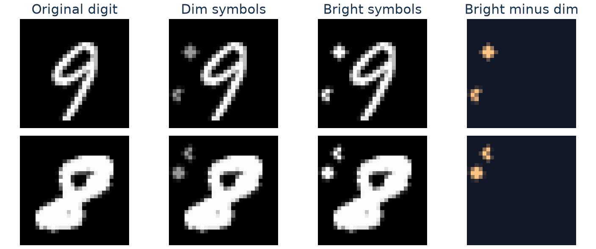

# Can the final IDEC encoder still read background brightness?

We refitted ordinary IDEC and adaptive Gaussian × aligned saliency on the same 12,000 digits, once clean and once with symbols, for five paired student seeds per training condition. Both students used uniform IDEC fine-tuning. For evaluation we froze each final encoder and changed only the brightness of the two background symbols on each image. This tests the final weighted method on an attribute drawn from the same generator used to demonstrate the drawback. [Design fixed before fitting](design.md) · [All twenty fits](per_seed.csv)



## What the readouts measure

- A linear probe learns a direction from differences between matched ten-dimensional codes. It selects which of two views of a new digit has brighter symbols. A separate linear probe sees one code and predicts dim or bright. Each digit appears with both labels. The first task removes variation between different people's handwriting by design.
- The mean whitened code distance measures the size of the brightness response on a common calibration scale. The cluster flip rate counts how often brightening the symbols changes the nearest IDEC center. Digit ACC averages the dim and bright views, using a mapping learned from the student's original fitting data after training. Each rate counts the same 4,000 held-out digits once per seed, and paired comparisons use the five student seeds.
- The readouts use 4,000 independent calibration digits and 4,000 other test digits from the original MNIST training pool. Teacher and student fitting use a disjoint set. One test candidate had insufficient room for two detached symbols. Before any fit we specified a geometry-only replacement rule and recorded the original and replacement IDs. The raw-pixel total identifies the brighter view for all 8,000 pairs.

## Results

After **training with background symbols**, the paired brightness readout averaged **91.93%** for ordinary IDEC and **93.35%** for the adaptive method. The weighted-minus-ordinary difference was **+1.42 percentage points** (sample SD 1.70, four of five positive). Single-image accuracy was 53.02% and 53.34%, close to the 50% chance level. Mean whitened displacement was about 0.25 for each encoder. Brightening the symbols changed **4.16%** of ordinary IDEC assignments and **3.19%** of adaptive assignments. This reduction occurred in all five seeds. Mean digit ACC across both marked views rose from **64.12% to 70.54%** (four of five positive).

The primary result does not support a reduction in the linear accessibility of this brightness difference. The adaptive model can encode the change while assigning both versions to the same digit cluster more often. A same-digit companion is available only to the paired readout. Its 93.35% accuracy does not imply that a single image reveals brightness that reliably. The experiment identifies one attribute of detached marks and leaves open how other background properties are represented. [Summary](summary.csv) · [Within-seed differences and sample SD](paired.csv) · [Per-image embeddings and cluster centers](results)

After **clean-only training**, paired brightness accuracy fell from **92.95% to 91.36%** (−1.59 points, sample SD 1.50). The cluster flip rate fell from **11.32% to 7.60%**. Both decreases occurred in all five seeds. On these particular marked views digit ACC rose from 62.87% to 70.43%. Identical-code pairs scored exactly 50%. With randomized within-pair labels, each condition's mean was within 0.05 points of 50%. The direction of the brightness-readout effect depends on what the encoder saw in training. Its ability to keep the digit cluster stable improved in both conditions.

## Reproduce

Run these commands from `IDEC` after installing the [project dependencies](../final/README.md).

```shell
python background_probe_analysis.py --output scratch/brightness_scores
python background_probe_figure.py --output scratch/brightness_pairs.png
python background_probe_study.py --device cuda --output scratch/brightness_refit
python background_probe_analysis.py --results scratch/brightness_refit --output scratch/brightness_refit_scores
```

The first command fits both linear readouts again on CPU from the archived, full-precision embeddings. The figure and model refit commands load checksum-verified MNIST. The fit uses the released domain-specific saliency maps. The student training objective has access only to the observed image and its pretraining weights. The generator supplies the readout's brightness labels for evaluation.
