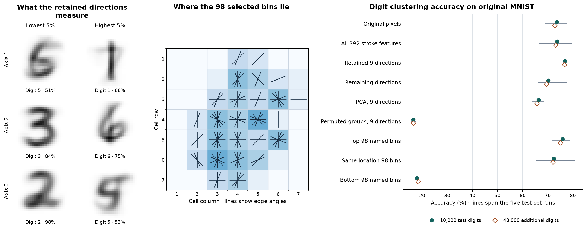

# Which features should IDEC reconstruct?

We evaluate two meanings of keeping a feature. One keeps nine learned combinations of local stroke measurements. The other keeps 98 named measurements, each a gradient orientation in one cell of the original image. Both selectors use only original, unlabeled training images. IDEC still receives the complete image and predicts a cluster from its encoder at inference.

The first rule finds groups twice, using disjoint training halves. A direction receives a high Fisher score when the groups that both halves recover have different mean responses and relatively little variation within each group. Ten groups support at most nine between-group directions. The second rule measures separation independently for each of the 392 bin responses, takes the lower of the two half-scores, and keeps the highest quarter. There are eight unsigned gradient orientations per 4-by-4-pixel cell. A gradient angle is perpendicular to the edge it measures. [Subspace protocol](design.md) · [Named-bin protocol](coordinate_design.md)

The released selectors can be applied to other 28-by-28 grayscale images represented as float32 intensities from zero to one. Run this from the IDEC directory with an array named `images`.

```python
import numpy as np
from cluster_feature_selection import stroke_features, coordinates

measured = stroke_features(images, "cpu")
with np.load("cluster_features/results/selector.npz") as fitted:
    retained_directions = coordinates(measured, fitted, "selected")
with np.load("cluster_features/coordinates/bins.npz") as fitted:
    retained_bins = measured[:, fitted["top"]]
```

## Held-out digit clustering

Of 12,000 training images, 9,917 received the same aligned group from the independent halves. The groups ranged from 72 to 1,795 agreed examples. We fitted the selector once, then retrained the student from five paired random initializations. The first column below uses the official test digits. The second uses the 48,000 other original training digits excluded from every fit in this experiment.

| Reconstruction target or clustering method | 10,000 test digits | 48,000 additional digits |
|---|---:|---:|
| Ordinary pixel IDEC | 73.63% | 72.80% |
| All 392 stroke features, IDEC | 73.76% | 73.12% |
| **Nine selected directions, IDEC** | **76.84%** | **76.71%** |
| Remaining span after removing those directions, IDEC | 70.19% | 69.51% |
| Nine PCA directions, IDEC | 66.34% | 65.71% |
| Nine directions estimated after permuting the unlabeled group IDs, IDEC | 16.38% | 16.45% |
| Ordinary pixel pretraining, DEC fine-tuning | 77.64% | 76.80% |
| Selected-feature pretraining, DEC fine-tuning | 77.13% | 77.77% |
| Frozen graph partition transferred by neighbor votes | 77.78% | 78.16% |

The selected target gained 3.21 ± 3.49 percentage points over pixel IDEC on the official test set and 3.90 ± 3.60 on the additional set. Four of five paired seeds improved on each set. It beat same-width PCA on every seed on both. From identical selected-feature pretraining, keeping reconstruction during fine-tuning changed accuracy by −0.29 and −1.06 points relative to DEC. The graph partitions used to select the features also clustered well on their own. These comparisons locate the gain relative to ordinary IDEC and limit the case for retaining a decoder during clustering. [All seed scores](results/runs.csv) · [Paired differences and stage comparisons](results/summary.json)

## Which individual features were retained?

| Reconstruction target, 98 named bins each | 10,000 test digits | 48,000 additional digits |
|---|---:|---:|
| Highest repeatable group-separation scores | **75.82%** | **75.00%** |
| Random orientations at the same spatial locations | 72.43% | 72.10% |
| Lowest group-separation scores | 17.87% | 18.36% |

The retained measurements occupy 30 of 49 spatial cells. The highest-scoring bin measures a 90° gradient, corresponding to a horizontal edge in the lower middle of the image (cell row 6, column 4 counting from one). The groups accounted for at least 67.65% of this bin's variance on each training half. The CSV uses zero-based indices. [All 392 named bins and scores](coordinates/bins.csv)

Top versus bottom won all five seeds on both holdouts. The top set beat the location-matched set by 3.39 ± 8.62 points on the official test and by 2.90 ± 8.58 on the additional set, with three wins out of five in each. The location-matched control shares 43 bins with the top set. The ranking distinguishes the high and low ends clearly. The additional benefit attributable to orientation choices at fixed locations varies across runs. Direct K-means on the top bins reached 69.18% on the official test, compared with 64.02% for the location-matched bins and 57.73% for an unrestricted random 98-bin subset. [Coordinate ablations and individual runs](coordinates/summary.json)



## What the features retain

K-means fitted directly on the nine selected measurements reached **76.71%** on the official test digits. On the complement it reached **54.69%**. A supervised linear readout fitted *after* the experiments reached **95.37%** on that same complement and **79.07%** on the nine selected measurements. The nine directions concentrate digit structure that is accessible to unsupervised clustering. The remaining measurements still contain substantial digit information when labels guide the readout.

The nine-dimensional target also carries less linearly readable writing style. Within a digit class, the held-out R² for ink mass fell from 0.70 with all stroke features to 0.19 with the nine selected features. For slant it fell from 0.96 to 0.37, for horizontal center from 0.63 to 0.02, and for vertical center from 0.47 to 0.02. These values describe the target feature coordinates. One example of digit-related structure is the third retained direction. Of the 600 training images in its lowest five percent, 590 were twos. Digit identities were counted only after fitting. [Target and style readouts](results/summary.json)

An exploratory readout also measures the final clustering decisions. Within each true digit, estimate a writing attribute from the assigned cluster using training means, with ten observations' worth of shrinkage toward the digit mean. On the official test set, the cluster ID's added R² for ink mass averaged 0.089 for pixel IDEC and 0.017 for selected-feature IDEC. For slant it averaged 0.172 and 0.153. The readout measures associations of the ten cluster decisions with style. The encoder could still carry further style information in its continuous latent vector.

## Reproduce and audit

Run these commands from the IDEC directory in the repository environment. Training uses the original MNIST IDX files via the project's verified loader. The second fitting command reuses the first experiment's unlabeled partition.

```powershell
python cluster_feature_study.py --output scratch/cluster_features
python cluster_coordinate_study.py --parent scratch/cluster_features --output scratch/coordinate_features
python cluster_feature_analysis.py --input scratch/cluster_features --prepare-probes
python cluster_coordinate_analysis.py --parent scratch/cluster_features --input scratch/coordinate_features
```

The two verification commands below rescore the released assignments and the post-fit probes offline. Each digit gets one cluster-to-digit mapping learned from the training assignments after fitting. A separate labeled linear digit probe audits how much digit information can be read from fixed feature coordinates. For the writing-style probes, subtract the training mean of each true digit class from features and style measurements, then fit a ridge model. Its held-out R² measures predictability beyond the digit-class mean.

```powershell
python cluster_feature_analysis.py --verify
python cluster_coordinate_analysis.py --verify
python cluster_feature_figure.py
```

The [initial training revision](https://github.com/JohnR31N/cs126FinalProj/commit/d4b11ec2e559aa47cd268b2027548305d6f19712) fixes the primary experiment. The [coordinate protocol and probe code](https://github.com/JohnR31N/cs126FinalProj/tree/3711e0b/IDEC) were recorded before holdout scoring. Passing an IDEC checkout of the initial training revision as `--training-source` verifies the primary source digests in the manifest. A later eigensolver fallback handles exactly repeated Fisher roots in a numerical fixture. The archived MNIST selector and its permuted-group control were both reproduced byte for byte with this update.
