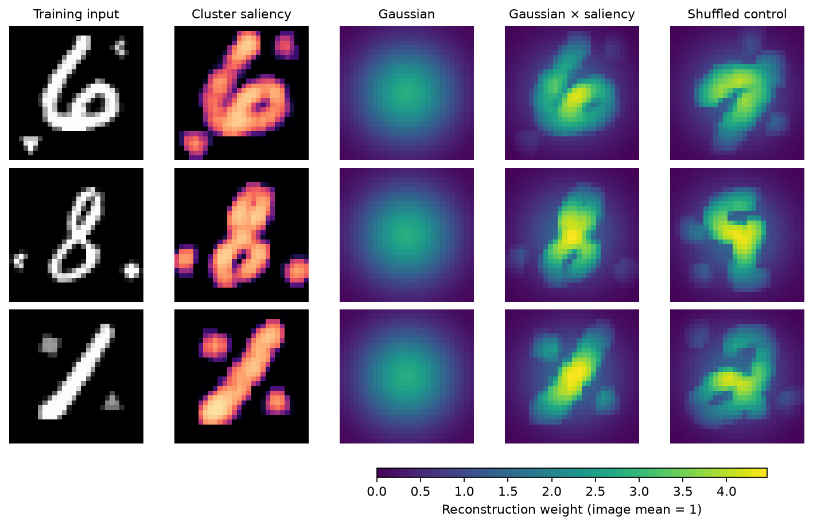

# Does cluster saliency help a Gaussian reconstruction prior?

The fixed Gaussian uses a pixel's location. The saliency map adds a signal from the observed image and its provisional cluster assignment. We train a pixel autoencoder and K-means on the unlabeled training split, then freeze that teacher. For each image, we compute how the margin between its two closest centers changes with each input pixel. We take the absolute input-times-gradient, smooth it over a 3-by-3 neighborhood and convert it to a bounded multiplier. It modulates the Gaussian reconstruction weight only during student pretraining. Ordinary IDEC fine-tuning follows. New images require only the student encoder and centers.

All comparisons use 12,000 fitting images, the 10,000 official MNIST test images and five paired student seeds. Each domain has a single additional teacher fit, shared across its three saliency arms. The pixel and fixed-Gaussian baselines come from the earlier matched study. The shuffled control uses every saliency map once, assigned to a different image; the teacher, spatial distribution and training budget match the aligned arm. The true digits and generator masks are used only for evaluation. This is an exploratory experiment on a previously examined test split. [Fitting protocol](design.md)



The rows are the first three marked training inputs in the fixed split. Brighter saliency pixels have higher values. The three weight panels share one color scale, with mean weight one in each image. In the second row both small symbols receive saliency; multiplying by the Gaussian reduces their weight near the margins.

| Pretraining weights | Clean train / clean test | Clean train / marked test | Marked train / marked test | Redraw flips, marked-trained |
|---|---:|---:|---:|---:|
| Uniform pixel IDEC | 73.23% | 64.62% | 65.14% | 2.99% |
| Fixed Gaussian | 74.07% | 68.92% | 68.80% | 2.62% |
| Saliency alone | 71.83% | 64.33% | 67.51% | 3.06% |
| Gaussian × aligned saliency | 75.95% | 71.51% | 70.52% | 2.38% |
| Gaussian × another image's saliency | 72.96% | 68.27% | 71.05% | 2.41% |

For clean-trained models, aligned maps improved accuracy over the fixed Gaussian on both clean and marked test images in every seed. On the marked test images the aligned maps also exceeded shuffled maps by 3.24 points (paired SD 5.93, four of five seeds). No marked images were used to train these teachers or students.

For marked-trained models, aligned Gaussian × saliency scored 70.52% against 68.80% for the fixed Gaussian. The paired gain was 1.72 points (sample SD 3.86, three of five seeds improved). Shuffled maps gave 71.05%. The aligned-minus-shuffled difference was −0.54 points (SD 4.42, two of five seeds improved). Redraw flips fell from 2.62% for the Gaussian to 2.38% for aligned and 2.41% for shuffled maps. Their similar outcomes leave the contribution of image-specific alignment unresolved in this training domain.

Average pixel weights on handwriting and added symbols, respectively, were 1.78 and 0.66 with the fixed Gaussian, 2.61 and 0.87 with aligned saliency, and 2.08 and 0.52 with shuffled saliency. Aligned weighting emphasized the handwriting more strongly and also raised the absolute per-pixel weight assigned to symbols. The attribution uses both intensity and a local cluster gradient. Either can respond to a bright geometric mark, even if it has no relation to digit identity.

## Reproduction

Run from the IDEC directory using the project environment.

```powershell
python gaussian_saliency_study.py --output scratch/gaussian_saliency
python gaussian_refinement_analysis.py --study gaussian_saliency --results scratch/gaussian_saliency --output scratch/saliency_tables
python gaussian_saliency_figure.py --results scratch/gaussian_saliency --output scratch/saliency.png
```

To rescore the archived predictions on CPU, run `python gaussian_refinement_analysis.py --study gaussian_saliency --output scratch/verified_saliency`. [Per-seed results](runs.csv) · [Paired differences and measured pixel weights](summary.json) · [Teacher maps and student predictions](results)
