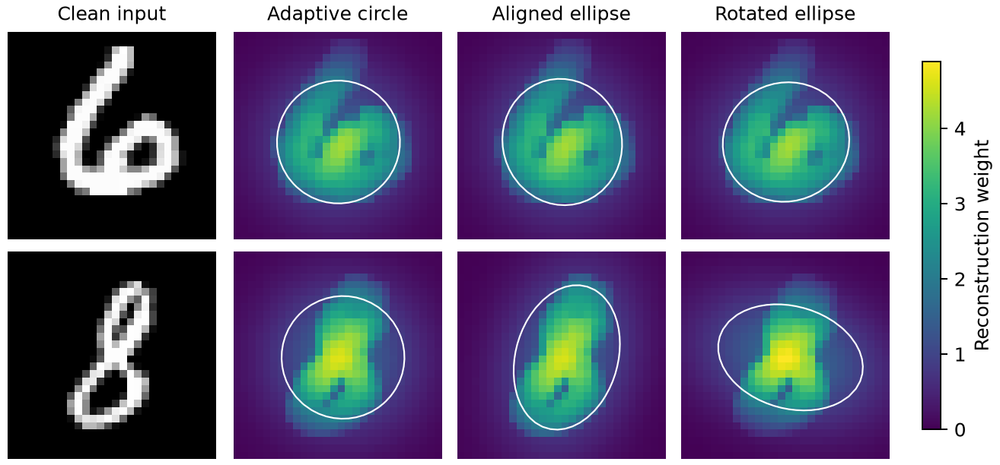

# Does adapting the Gaussian shape help?

This follow-up evaluates the final project's Gaussian × saliency objective on a second set of digit/background pairs. The published circular method moves a seven-pixel-wide Gaussian to the intensity centroid of each image. On the 12,000 clean fitting images that moves the center only **0.67 pixels on average** (95th percentile 1.21). The new method also estimates a principal direction and elongation from the same intensity distribution. Elongation averages 1.31:1. [Geometry measurements](weights.json)



The white curve marks the Gaussian's half-maximum contour. All heatmaps share a weight scale. Every weighted arm uses the exact same clean teacher saliency map. Each map is normalized to mean one per image before computing pretraining MSE. The aligned and rotated ellipses share a center, elongation and continuous area. The rotated control swaps only the major and minor axes. Test-time inference is identical for all five methods.

## Evidence

| Pretraining weights | New clean | New marked | Official marked, refit | Eligible marked | Same pairs shifted |
|---|---:|---:|---:|---:|---:|
| Ordinary IDEC | 73.25% | 64.65% | 65.72% | 65.74% | 19.68% |
| Fixed circle × saliency | 75.67% | 70.53% | 71.01% | 71.75% | 23.40% |
| Adaptive circle × saliency | 75.91% | 70.65% | 71.11% | 71.50% | 23.84% |
| Aligned ellipse × saliency | 76.10% | 70.98% | 71.42% | 71.84% | 23.56% |
| Rotated ellipse × saliency | 74.45% | 69.09% | 69.28% | 69.90% | 23.29% |

The five paired holdout differences for aligned ellipse minus adaptive circle were −1.31, +1.02, −3.85, +1.83 and +3.96 percentage points. Their mean was **+0.33 points**, with sample SD 3.00. The official marked difference was +0.31 points. The aligned ellipse gained 1.89 points over its rotated control on the new holdout (three positive seeds, paired SD 4.23). Since the ellipse won three of five comparisons against the circle, the four-win decision rule retains the **adaptive circle × aligned saliency** as the default.

Adding symbols changed the assignments of 10.57% of digits with the circle and 10.09% with the ellipse. Decoder response fell from 0.00445 to 0.00377. Both measures decreased in every seed. Elongation thus reduced sensitivity to this nuisance more consistently than it improved digit accuracy. Moving the whole image exposed a larger weakness shared by all arms. On eligible marked pairs, for example, the circular model fell from 71.50% to 23.84%. The shape study refitted every arm; its 71.11% official circular score and the original archived 71.59% are separate sets of five fits.

[Training design frozen before fitting](design.md) · [Uniform reference specified before scoring](reference_design.md) · [Five-seed means and SDs](means.csv) · [Per-seed scores](per_seed.csv) · [Paired contrasts](paired.csv) · [Model decision](decision.json)

The marked holdout uses the next 10,000 training-set IDs after the 12,000 fitting IDs in a fixed random permutation. Its marks have newly drawn positions and attributes, and no test pairs enter fitting. A second evaluation uses the exact official pairs from v2.0. The offset stress test translates the entire clean/marked image pair three pixels in a preassigned cardinal direction where every original stroke and mark fits. This yields 4,879 eligible pairs. Only their centered predictions are used as the comparison for their shifted predictions.

## Reproduce

Use the [project environment](../final/README.md). Run from the `IDEC` directory. Rescoring does not require MNIST, network access or a GPU.

```shell
python gaussian_shape_analysis.py --output scratch/shape_scores
```

The script verifies both source manifests, the clean teacher-map digest, the evaluation index pairing, the full 25-fit inventory and predicted cluster IDs. A Hungarian mapping learned from each model's training assignments after fitting is reused on every view. The results record accuracy, assignment flips when adding marks, and decoder response (the projection of the output change onto the added pixels divided by the energy of those pixels). A decoder that copies the added signal perfectly has response one.

To train the candidate alone, including its teacher from raw MNIST:

```shell
python fit_final.py --shape ellipse --seed 0 --output scratch/ellipse_fit
```

A separate end-to-end seed-0 run regenerated the teacher and scored 77.14% clean and 71.51% marked on the official test. Its counterpart in the matched, archived-map shape study scored 77.44% and 72.00%. These additional predictions are excluded from the five-seed contrasts. [Refit metrics](refit/metrics_ellipse_0.json) · [Refit assignments](refit/clean_ellipse_aligned_0.npz)

To rerun all five seeds with the common archived teacher maps, fit all five arms and rebuild the evidence:

```shell
python gaussian_shape_study.py --output scratch/shape_fits
python gaussian_shape_reference.py --evaluation scratch/shape_fits/evaluation.npz --output scratch/shape_uniform
python gaussian_shape_analysis.py --results scratch/shape_fits --reference scratch/shape_uniform --output scratch/shape_scores
python gaussian_shape_figure.py --output scratch/shape_scores/weights.png
```

The figure command also writes the pooled training-geometry measurements to `weights.json`. All fitting and plotting commands use the verified MNIST loader. The four weighted arms use 100 epochs of weighted pretraining and 5,600 ordinary fine-tuning updates. The uniform reference uses the identical student budget. [Saved weighted-arm outputs](results) · [Saved ordinary IDEC outputs](reference)
