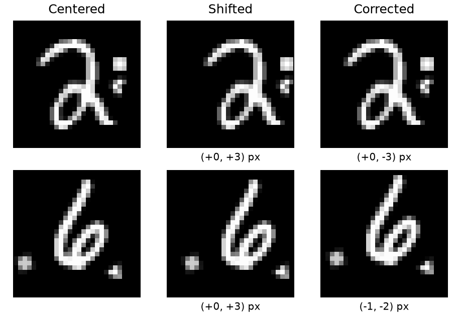

# Supplementary position test on frozen IDEC models

The reconstruction method remains adaptive circular Gaussian × aligned saliency. This option uses the same student to handle an additional problem at inference: positions outside the range seen in the clean fitting data. The first shape study revealed that moving an entire marked image by just three pixels sharply reduced accuracy. We specified one correction rule before testing it on another 10,000 digits with newly drawn backgrounds.

## How it works

Estimate the ordinary Gaussian-weighted centroid of every clean fitting image, then take the median row and median column as the reference position. The 99th percentile of fitting distances to this point gives the threshold. On one new image, compare its observed centroid to this reference. Beyond the threshold, round the vector toward the reference, cap each component at three pixels and clamp it so every nonzero pixel stays inside the frame. Move the entire image by this single integer offset. No pixel is erased, rescaled or inpainted. Only the frozen student encoder and the three calibration scalars are needed at inference along with the cluster centers. The correction uses the observed pixels, with no clean counterpart or symbol masks.

The fitted reference is (13.746, 13.934) in (row, column) coordinates and the threshold is 1.129 pixels. Among centered images, the rule actually moved 1.05% of clean digits and 4.28% of marked digits. It moved 88.48% of eligible shifted marked digits.



The examples use the first two shift-eligible images in the study's fixed order. Labels give (vertical, horizontal) offsets. The first correction exactly restores the original position. In the second, the inferred shift recovers only part of the displacement.

## Paired held-out results

| Condition | Digits | Raw input ACC | With correction | Paired gain |
|---|---:|---:|---:|---:|
| Clean | 10,000 | 75.10% | 75.06% | −0.04 pp |
| Marked | 10,000 | 69.73% | 69.45% | −0.27 pp |
| Eligible marked, centered | 4,862 | 70.44% | 70.16% | −0.27 pp |
| Same marked digits, shifted three pixels | 4,862 | 22.89% | 52.48% | **+29.59 pp** |
| Same clean digits, shifted three pixels | 4,862 | 26.16% | 63.89% | **+37.73 pp** |

Every comparison uses one frozen encoder and one training-derived cluster mapping per seed. Shifted marked accuracy improved in all five seeds (+28.67 to +31.10 points, paired sample SD 0.97). Both centered mean losses were below the predefined one-point tolerance. This supports the option for this displacement setting. Even after correction, the marked accuracy of 52.48% is below the same pairs' centered 70.44%. Conditional centering addresses image position and leaves the training reconstruction objective intact. A separate same-input reconstruction-target experiment provides the evidence about learning background information.

The student, teacher maps and calibration use only the original 12,000 clean fitting images. The new marked and shifted views come from the next 10,000 disjoint MNIST training-pool indices after the shape holdout, with new symbol settings and directions. The shifted subset accepts the preassigned direction only if the entire marked observation fits. An independent evaluation-only inverse using the known shift restores every digit and symbol pixel exactly. The unchanged centered-subset accuracy is therefore the score the known inverse obtains. All differences above are computed from unrounded per-seed values.

[Decision and calibration](summary.json) · [Per-seed effects](per_seed.csv) · [Prespecified test](design.md) · [Per-image cluster IDs and applied offsets](results)

## Reproduce

From the project `IDEC` directory with the [environment set up](../final/README.md):

```shell
python position_alignment_analysis.py --output scratch/position_scores
python position_alignment_analysis.py --output scratch/position_scores --figure
python position_alignment_study.py --output scratch/position_fits
python position_alignment_analysis.py --results scratch/position_fits --output scratch/position_refit_scores
```

Rescoring requires no GPU or MNIST download. Figure rendering and fitting use the verified IDX files. The supplementary study uses the released clean teacher maps to fit five students and measures position sensitivity after fitting. The [main project](../final/README.md) uses adaptive Gaussian reconstruction and evaluates inputs at their observed coordinates. [Position-test implementation](../position_alignment.py)
