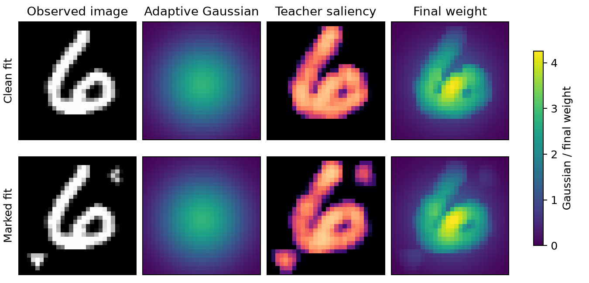

# Adaptive Gaussian reconstruction for IDEC

**John Zhang and Ryan Jian · COSI 126A final project**

Uniform reconstruction rewards an IDEC decoder for copying both digit strokes and unrelated marks. Our method weights reconstruction with a **circular Gaussian centered separately on each observed image**, with a fixed width of seven pixels. The center is an intensity centroid under a broad central prior. That image's cluster saliency modulates the Gaussian before we normalize its weights to mean one. We apply these weights only to student autoencoder pretraining. Ordinary IDEC fine-tuning and inference use the observed images at their original coordinates. The primary teacher and students train on clean unlabeled digits.

[Research report (PDF)](IDEC/report/report.pdf) · [Presentation (PDF)](IDEC/slides/slides.pdf) · [Complete project ZIP](https://github.com/JohnR31N/cs126FinalProj/releases/download/idec-final-v2.1/IDEC_final.zip) · [Reproduction commands and sources](IDEC/final/README.md)

## Evidence for the drawback

On matching clean and marked domains, DEC fell from 77.63% to 70.86% and IDEC from 73.23% to 65.14%. Adding two detached geometric symbols made clustering harder for both methods. In a separate experiment we kept every marked input identical and changed the decoder target. When the target omitted the symbols, digit accuracy rose from **65.40% to 71.44%**, with a gain in all five seeds. That intervention isolates a cost of rewarding background reconstruction. The clean target is available only for this diagnostic. [Target intervention and per-seed effects](IDEC/varied/results/paired.json) · [Matched DEC and IDEC results](IDEC/dec_background/results/summary.csv)

## Final ablation

The primary evaluation fits on 12,000 clean MNIST digits and adds symbols only at test time. The digit identity and every original stroke pixel stay fixed. Scores are mean clustering accuracy on 10,000 held-out digits across five paired student seeds.

| Pretraining weights | Clean fit / clean test | Clean fit / marked test | Marked fit / marked test |
|---|---:|---:|---:|
| Ordinary IDEC | 73.23% | 64.62% | 65.14% |
| Fixed Gaussian | 74.07% | 68.92% | 68.80% |
| Saliency only | 71.83% | 64.33% | 67.51% |
| Adaptive Gaussian | 76.20% | 70.28% | 69.71% |
| Fixed Gaussian × aligned saliency | 75.95% | 71.51% | 70.52% |
| Adaptive Gaussian × shuffled saliency | 73.80% | 68.47% | 68.63% |
| **Adaptive Gaussian × aligned saliency** | **76.10%** | **71.59%** | **71.06%** |

On the primary endpoint, the final model gained **6.98 percentage points** over ordinary IDEC (all five seeds) and **3.12 points** over shuffled saliency with the same adaptive center (four of five). Moving the Gaussian center while keeping aligned saliency added only **0.09 points** (two of five). Background-induced accuracy loss fell from 8.62 to 4.50 points. These comparisons use unrounded within-seed differences. [Per-seed scores](IDEC/final/per_seed.csv) · [Paired contrasts](IDEC/final/paired.csv)

For context, clean-trained **DEC reached 75.62% on the same marked test**, above the final IDEC variant in each of the five seeds. DEC uses reconstruction for initialization and clustering loss alone during fine-tuning. [Matched DEC runs](IDEC/dec_background/results/runs.csv)

## Does adapting the shape help?

The [shape follow-up](IDEC/gaussian_shape/README.md) adds 25 clean-trained fits and a second 10,000-digit marked holdout. Ordinary IDEC scored **64.65%**, the adaptive circle **70.65%**, and a Gaussian elongated along the observed strokes **70.98%**. The ellipse reduced cluster changes after adding symbols in all five seeds, but raised accuracy over the circle in only three. The adaptive circle remains the final method under the prespecified four-of-five rule.

## Original paper reproduction on full MNIST

Guo et al. report **88.06%** on full MNIST. Our author-checkpoint reproduction reaches **88.10%** on the same 70,000 images used for fitting. The 73.23% ordinary IDEC control above has different initialization, training size, update budget and evaluation data. The final weighting has been evaluated in the held-out experiment. [Original paper](https://www.ijcai.org/proceedings/2017/243) · [Reproduction record](IDEC/reference/result.json)

## Project files

- [Run the final experiments or rebuild the tables and plots](IDEC/final/README.md)
- [Editable report](IDEC/report/report.tex) and [editable Beamer slides](IDEC/slides/slides.tex)
- [Earlier IDEC studies](IDEC/README.md), including reconstruction targets, training stages, whole-image translation and feature selection. The external dataset results concern earlier methods.
