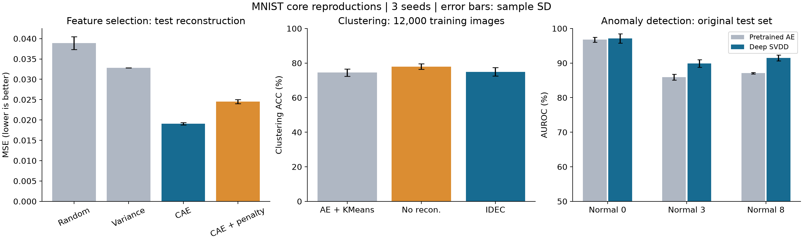
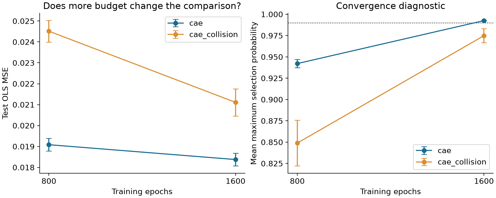

# COSI 126A Final Project: paper selection and core reproductions

本目录用于选题研究与先导复现实验。已经调研作业列出的五篇论文，并为 **Concrete Autoencoders、Deep SVDD、IDEC** 实现可运行的核心复现。它不是最终课程提交包；最终作业需要围绕一篇论文形成完整的假设、修改、实验、报告和演示。

先看下面的结果图、[逐次结果](results/pilot/runs.csv) 和 [统计汇总](results/pilot/summary.json)。克隆后可在浏览器打开 `results/pilot/review.html` 查看完整交互链接。课程作业原件仅保留在本地；公开仓库通过下方原始论文链接记录选题来源。





## 我的推荐

**优先选 Concrete Autoencoders；异常检测方向选 Deep SVDD；希望延续聚类方向则选 IDEC。** 这个排序考虑课程研究问题是否容易检验、对照是否清楚、实验是否便宜，以及是否有可解释的结果，不是论文声望或不同任务分数的排名。

| 顺序 | 论文 | 有价值的问题 | 复现和研究成本 | 判断 |
|---|---|---|---|---|
| 1 | Concrete Autoencoders, ICML 2019 | 选出的特征是否重复、是否稳定；不同像素数和重建质量是什么关系；训练预算如何改变结论 | 线性版本简单，能做多种子和预算消融，像素选择可视化直接 | 最适合形成边界清楚、容易讲明白的课程研究 |
| 2 | Deep One-Class Classification / Deep SVDD, ICML 2018 | 正常训练集混入异常后，中心和表示如何偏移；截尾训练会不会丢掉罕见正常样本 | 作者 PyTorch 代码可用；必须遵守无 bias、固定中心等约束；多类别实验较多 | 很适合实际异常检测问题，但不能只比较一个正常类别 |
| 3 | IDEC, IJCAI 2017 | 重建会同时保留语义结构和无关变化；重建权重何时帮忙、何时拖累聚类 | 原始网络和损失易实现，预训练、尺度、目标刷新对结果敏感 | 聚类方向最稳妥的起点；需要真正的失败条件，不能只调 gamma |
| 4 | Partial Multi-View Clustering, AAAI 2014 | 成对可见样本是否能代表所有簇；非随机缺失会不会使跨视图对齐偏置 | 作者提供 MATLAB；需要核对 NMF 约束、数据对齐、缺失掩码和视图尺度 | 研究问题很有价值，但数据协议与移植验证成本比前三篇更高 |
| 5 | VaDE, IJCAI 2017 | 固定 K、对角高斯混合、类不平衡和非高斯潜在结构之间有什么冲突 | 需同时核对 ELBO、责任度、方差正性与初始化；作者代码依赖旧 Keras/Theano | 理论学习价值高，但作为这次 final 的首选，数值与实现风险较高 |

### 为什么 CAE 值得做

CAE 将每个选择槽位写成一个 Gumbel-Softmax / Concrete 分布，在训练时用可微的特征组合，在评估时用每个槽位最大 logit 对应的真实输入特征。与 PCA 不同，它真正选择输入列，适合讨论测量成本、传感器数量或基因子集。这里复现的是论文 **4.2 的线性解码器 + 选后 OLS 重拟合**，不是其所有非线性实验。

“独立槽位会重复选择”不是尚未被发现的问题。**Nilsson et al. ICML 2024 的 IP-CAE 已经研究重复选择、训练不稳定及正则化对照**。因此本项目不能把加去重惩罚作为新的领域贡献。课程允许从已有缺陷出发做严谨检验，适合提出更窄的问题：

> 在相同特征预算和训练预算下，减少重复选择是否足以改善泛化？如果原始选择器最终已经没有重复，持续施加多样性惩罚是否反而有害？

当前实现包含原始 CAE 与固定 `lambda=0.1` 的概率碰撞惩罚，另有随机选择和高方差选择两项对照。原始 CAE 和修改版使用相同初始化、批次顺序、温度退火和训练预算。**增加不同特征的数量不是成功标准；必须同时检查测试重建误差。**

在发现 800 epoch 的六个选择器都未达到 0.99 收敛标准后，追加了双方均为 1600 epoch、从头训练的预算对照。假设和决策时点见 [budget_followup_plan.txt](research/budget_followup_plan.txt)，配置见 [budget1600.json](configs/budget1600.json)。这是明确标注的探索性追加实验；两组预算的全部结果都保留。

这个先导实验只在普通 MNIST 上比较，没有人为制造大量重复特征；因此它检验的是无条件加入惩罚的行为，不能代表真正严重重复场景下的结果。800 epoch 也不是论文“训练至平均最大概率超过 0.99”的完整停止规则。收敛不足和错误惩罚强度仍是可能解释。

### 另外两条可选主线

**Deep SVDD：训练污染与稀有正常模式。** 原方法将正常数据映射到固定中心附近，异常分数是到中心的平方距离。可固定每个正常类别的原始样本数，额外引入 0%、1%、5%、10% 异常，比较 one-class、soft-boundary 和预先定义截尾比例的鲁棒版本；训练时不暴露污染标签，标签仅用于构造实验和评估。另做正常子簇不平衡，检查截尾是否把少数正常模式误删。报告 AUROC、每个正常子群召回/误报和 clean-data 损失。污染鲁棒性已有 LOE 等相关工作，不能把这个方向描述成未经研究。

**IDEC：重建目标何时保留无关信息。** 固定真实类别结构，逐级加入背景、独立噪声或强度扰动；比较同初始化的无重建、标准重建和一个明确定义的去噪/加权重建方案。所有方法采用相同数据、相同种子和相同训练预算，并同时看 ACC/NMI、重建质量及扰动敏感性。普通 MNIST 上的胜负不能证明这个假设，必须加入可控失败条件。

## 已固定的实验协议

完整配置见 [configs/pilot.json](configs/pilot.json)，运行前的假设和对照见 [research/experiment_plan.txt](research/experiment_plan.txt)。

- 随机种子为 0、1、2。固定数据划分种子 126，从 MNIST 原始 60,000 训练图中随机选 12,000 训练图和独立的 3,000 验证图。原始 10,000 测试图保持独立。划分索引已保存。
- CAE 和 IDEC 的训练损失均不接触类别标签。IDEC 的标签仅用于报告；停止条件仅使用预测标签变化。CAE 下游分类器在完成无监督选择后单独使用训练标签。
- Deep SVDD 依照 one-class 标准协议，用数据集标签构造正常类别训练集；优化本身不接触异常标签。类别 0、3、8 各使用完整正常训练子集，测试全部 10,000 图，共 9 次运行。
- 报告所有种子、均值与样本标准差 (`ddof=1`)，不选择最佳种子。只有三个种子，不进行强显著性声明。
- 任务不同，CAE 的分类准确率、IDEC 的聚类 ACC、SVDD 的 AUROC 不可直接横向排名。

| 方法 | 保留的核心 | 与论文或官方运行的主要差异 |
|---|---|---|
| CAE | 独立 Concrete 选择器、指数温度 10→0.01、Adam 0.001、50 槽位、线性重建、选后 OLS、50-tree ExtraTrees | 12,000/3,000/10,000 数据划分；固定 800 epoch；PyTorch 实现；未完整复现论文基线方法集与所有数据集 |
| IDEC | `784-500-500-2000-10` 及镜像 decoder；uint8/50 缩放；Student-t Q、平方/频率修正 P；`MSE + 0.1 KL`；140 步全局 P 刷新 | 100 epoch 普通 AE 预训练代替逐层 denoising；训练 12,000 点代替全 70,000 点；最大 4,000 步 |
| Deep SVDD | 作者 CNN/AE、GCN L1 和作者 min/max、无 bias、非 affine BN、固定非零中心、距离平方目标 | 用作者 PyTorch README 的 150+150 epoch 配置；只选三个正常类、三个种子；现代 scheduler 顺序与 tensor loader；论文原始预算与激活斜率不同 |

IDEC 的 `dec_ablation` 只删除重建项，保留同样的聚类系数和优化器，用来隔离重建项；**它不是原论文 DEC 全训练流程的复现**。Deep SVDD 的 AE AUROC 来自 150 epoch 预训练终点，而 SVDD 多训练 150 epoch，因此 AE 列是流程诊断而非等计算量的竞争对照。

## Setup and reproduction

Tested locally on Windows, Python 3.12.15, NVIDIA RTX 5080 16 GB, PyTorch 2.11.0+cu128. All dependencies are isolated in `.venv`; no other workspace environment is modified. See `requirements-lock.txt` for the resolved environment.

```powershell
uv venv .venv --python 3.12
uv pip install --python .venv/Scripts/python.exe -r requirements.txt
uv pip install --python .venv/Scripts/python.exe torch==2.11.0 torchvision==0.26.0 --index https://download.pytorch.org/whl/cu128

.venv/Scripts/python.exe main.py download
.venv/Scripts/python.exe main.py check
.venv/Scripts/python.exe main.py run
.venv/Scripts/python.exe main.py report
```

Run a specific method or seed:

```powershell
.venv/Scripts/python.exe main.py run --method cae --seeds 0 1 2
.venv/Scripts/python.exe main.py run --method idec --seeds 0 1 2
.venv/Scripts/python.exe main.py run --method svdd --seeds 0 1 2
.venv/Scripts/python.exe main.py run --method cae --config configs/budget1600.json --output results/budget1600
```

Completed run folders are skipped. Use a **new output directory** when changing configurations; existing results must not be mixed with a different protocol:

```powershell
.venv/Scripts/python.exe main.py run --config configs/pilot.json --output results/fresh_run
.venv/Scripts/python.exe main.py report --output results/fresh_run
```

The report command validates the complete three-seed grid. It regenerates figures and tables from saved runs, recomputes CAE evaluation from selected features and original data, and recomputes IDEC and SVDD metrics from saved predictions/scores. It does not retrain neural networks. The Deep SVDD forward-parity test uses the small, pinned MIT-licensed fixture in `tests/fixtures/deep_svdd`; no separate upstream checkout is required.

The same report command incorporates `results/budget1600` when the complete follow-up grid is available. The budget follow-up is supplementary and does not replace the pilot grid.

The public repository includes all recorded metrics, scores, selected features, training histories and plots. Download the 30 trained checkpoints from [Release v1.0.0](https://github.com/JohnR31N/cs126FinalProj/releases/tag/v1.0.0) to reproduce checkpoint verification. The release archive contains only model files and a per-file SHA-256 manifest. Extract it into the repository root so that the files appear under `results/`:

```powershell
gh release download v1.0.0 --repo JohnR31N/cs126FinalProj --pattern 'checkpoints-v1.*' --dir artifacts
Get-FileHash artifacts/checkpoints-v1.zip -Algorithm SHA256
Get-Content artifacts/checkpoints-v1.sha256
Expand-Archive artifacts/checkpoints-v1.zip -DestinationPath .
```

The printed archive hash must match the `.sha256` file. On Linux, use `sha256sum -c checkpoints-v1.sha256` from the download directory, then unzip into the repository root. Replace `.venv/Scripts/python.exe` with `.venv/bin/python` in the reproduction commands. Training and the checkpoint verification script require a CUDA GPU with the provided configuration.

Reload every trained final checkpoint and verify its saved predictions or selected features:

```powershell
.venv/Scripts/python.exe scripts/verify_saved_runs.py
```

To rebuild the model-only release asset locally, run `.venv/Scripts/python.exe scripts/package_checkpoints.py`. The original local handoff archive, course handout, downloaded papers, environment and dataset caches are excluded from Git. Data downloads are verified automatically and original paper URLs are recorded. This repository contains research pilots; it is not a final submission with slides and a final paper.

Metrics recomputed from saved clustering labels and AUROC scores must reproduce to `1e-12`. Float32 OLS is checked with relative tolerance `1e-5` and absolute tolerance `1e-8`; sparse or collinear random pixel subsets can show small numerical differences across refits. Actual maximum discrepancy is recorded in `validation.json`. This is not a claim of bitwise reproducible training or linear algebra.

Checkpoint verification reloads 27 final CAE/IDEC/SVDD models and checks their scores, labels or selected indices. It also reloads three pretrained AEs and repeats KMeans as a separate diagnostic. An observed refit of seed2 changed ACC by -0.0001667 (0.0167 percentage points) and NMI by about -0.000542; the original metrics remain preserved. These refits are not claimed to be bitwise identical. Full observed differences are saved in `results/checkpoint_verification.json`.

The data downloader obtains the four original MNIST IDX gzip files from the same S3 mirror used by torchvision. Every file is checked against its known MD5, and its download URL and SHA-256 are stored in `data/mnist/manifest.json`.

## Organization and provenance

```text
main.py                    thin command-line entry point
src/data/                  verified MNIST data, splits, GCN
src/method/                CAE, IDEC, SVDD and attributed SVDD network
src/eval/                  clustering metrics, reports and figures
src/utils/                 seeds, IO, timing and minibatches
src/cli/                   experiment orchestration
configs/                   fixed experimental protocol
tests/                     numerical oracles, gradients, upstream parity, data integrity
results/pilot/             config, splits, per-seed histories, scores, tables
results/budget1600/        complete follow-up results for the larger CAE budget
figures/                   regenerated static figures
research/sources.json      original URLs, document hashes, pinned commits
tests/fixtures/deep_svdd/  original MIT-licensed upstream forward-parity fixture
artifacts/                 downloaded/rebuilt Release assets (not in Git)
```

CAE and IDEC are independently written PyTorch implementations of the cited mathematical methods. Author code was consulted to verify behavior; these are not unmodified executions of the legacy TensorFlow/Keras programs. Deep SVDD's `svdd_network.py` adapts the author's MIT-licensed `mnist_LeNet.py`, replacing its empty wrapper base class with `nn.Module` without changing architecture or forward operations. The license is preserved in [research/DEEP_SVDD_LICENSE.txt](research/DEEP_SVDD_LICENSE.txt). Exact forward parity against upstream is tested.

The original start-of-run source hash file predates one reviewed correction to IDEC input scaling; no IDEC result had yet been produced. The effective IDEC source snapshot is separately recorded in `results/pilot/idec/implementation.json`. Analysis/report code was added while experiments ran and does not alter training. Final delivery hashes identify the completed files.

## What would make this a final research project

For CAE, keep the anchor paper fixed and test a predeclared factorial design: ordinary versus duplicated/correlated/noisy input features, small versus larger selector budgets, and short versus convergence-driven training. Compare the baseline, always-on penalty and one explicitly defined conditional penalty, using at least five seeds and a second dataset (for example Fashion-MNIST). Select hyperparameters with validation reconstruction only. Include OLS and matched nonlinear decoders, final unique-feature count, convergence, feature-group recovery where ground truth exists, and wall time. A useful negative result is that duplicate removal helps one condition but hurts another; novelty claims must acknowledge IP-CAE and related feature-selection work.

For a full numerical reproduction, first restore each paper's dataset split, preprocessing, pretraining, stopping rule and full baseline suite. Do not compare these pilot means to a paper table as if all those conditions were identical.

## Primary references

1. Guo et al. [Improved Deep Embedded Clustering with Local Structure Preservation](https://www.ijcai.org/proceedings/2017/243), IJCAI 2017. [Author code](https://github.com/XifengGuo/IDEC), commit `4a661c211f082022249758ab3312f7db21e2aa99`.
2. Jiang et al. [Variational Deep Embedding](https://www.ijcai.org/proceedings/2017/273), IJCAI 2017. [Author code](https://github.com/slim1017/VaDE), commit `eca52b4b57e32a68f578de7a54eda5d39907b0fe`.
3. Li, Jiang and Zhou. [Partial Multi-View Clustering](https://www.lamda.nju.edu.cn/publication/aaai14pvc.pdf), AAAI 2014. [Author MATLAB package](https://www.lamda.nju.edu.cn/code_PVC.ashx). The assignment's AAAI page blocked automated access; the author-hosted original paper was read instead.
4. Balin, Abid and Zou. [Concrete Autoencoders](https://proceedings.mlr.press/v97/balin19a.html), ICML 2019. [Author code](https://github.com/mfbalin/Concrete-Autoencoders), commit `cc9ba622ac30f4c21f96cdbf2f450d591817e08b`.
5. Ruff et al. [Deep One-Class Classification](https://proceedings.mlr.press/v80/ruff18a.html), ICML 2018. [Author PyTorch code](https://github.com/lukasruff/Deep-SVDD-PyTorch), commit `1901612d595e23675fb75c4ebb563dd0ffebc21e`.
6. Nilsson et al. [Indirectly Parameterized Concrete Autoencoders](https://proceedings.mlr.press/v235/nilsson24b.html), ICML 2024. Related work, not reproduced here.
7. Shaham et al. [Deep Unsupervised Feature Selection by Discarding Nuisance and Correlated Features](https://arxiv.org/abs/2110.05306). Related work for the correlated/nuisance-feature proposal, not reproduced here.
8. Qiu et al. [Latent Outlier Exposure for Anomaly Detection with Contaminated Data](https://proceedings.mlr.press/v162/qiu22b.html), ICML 2022. Related work for the SVDD contamination proposal, not reproduced here.

VaDE and PVC were researched but not run. No remote compute resources or TPU nodes were used.
