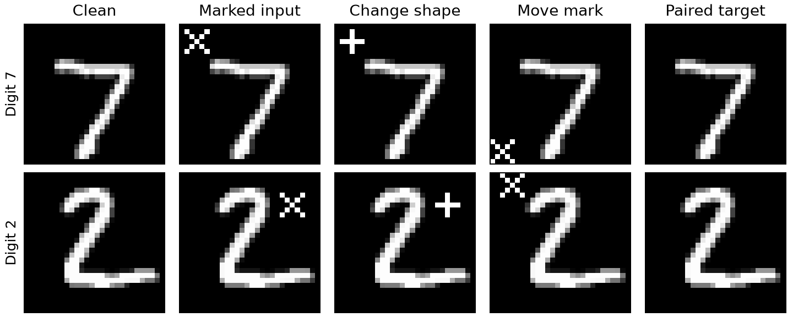

# What Does IDEC Preserve?

**John Zhang and Ryan Jian** · COSI 126A final project

We reproduced IDEC on MNIST at **88.10%** clustering accuracy (paper **88.06%**). Our project studies a tension in full-image reconstruction: a model is rewarded for remembering a decoration even when digit identity defines the intended grouping. In our geometric test, we move or replace a mark without changing any handwritten pixel. We compare background augmentation, paired-view denoising and a Gaussian spatial prior across five matched seeds.

Moving the mark changed **6.20%** of ordinary IDEC assignments. Background augmentation reduced this to **4.34%**, with a reduction in every seed. A paired target gave the weakest decoder response to the mark. A fixed Gaussian gave the highest mean digit accuracy on marked images (**72.91%**).

[Read the report](IDEC/report/report.pdf) · [View the slides](IDEC/slides/slides.pdf) · [Download the submission package](https://github.com/JohnR31N/cs126FinalProj/releases/download/idec-final-v1.5/IDEC_final.zip)

The [project README](IDEC/README.md) gives setup and reproduction commands. See the [geometric design](IDEC/background/design.md), [results](IDEC/background/results/summary.csv), and [paired effects](IDEC/background/results/paired.json). Earlier [additive stripe](IDEC/design.md) and [training-stage](IDEC/stage/design.md) experiments are included with their original data.
