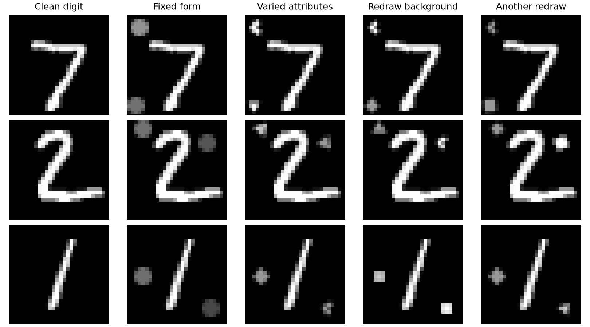

# What Does IDEC Preserve?

**John Zhang and Ryan Jian** · COSI 126A final project

Our proposed modification to IDEC is a **Gaussian center prior for reconstruction**. A pixel error near a centered MNIST digit receives more weight than an equal error near the margin. Two detached background symbols let us measure how this choice affects digit clustering. Training uses pixel coordinates and the observed image.

[Read the report](IDEC/report/report.pdf) · [View the slides](IDEC/slides/slides.pdf) · [Download the current project](https://github.com/JohnR31N/cs126FinalProj/archive/refs/heads/main.zip) · [Archived v1.9 background study](https://github.com/JohnR31N/cs126FinalProj/releases/download/idec-final-v1.9/IDEC_final.zip)

## Where to apply the Gaussian prior

The prespecified experiment applied Gaussian weights in both training stages. Weighting only autoencoder pretraining gave the highest marked accuracy among the three Gaussian placements. This variant returns to ordinary IDEC after K-means initialization.

| Reconstruction weighting | Clean ACC | Marked ACC |
|---|---:|---:|
| Ordinary pixel IDEC | 73.23% | 65.14% |
| Gaussian in both stages | 70.03% | 65.59% |
| **Gaussian in pretraining only** | **74.07%** | **68.80%** |
| Gaussian in fine-tuning only | 69.27% | 62.88% |

Pretraining-only weighting improved marked accuracy by 3.66 percentage points on average (four of five paired seeds, sample SD 4.74). Weighting both stages narrowed the clean-to-marked drop to 4.44 points, partly because clean accuracy fell by 3.20 points. These are held-out results from 12,000 fitting images. The separate paper reproduction reached 88.10% on all 70,000 clean images. [Experiment design](IDEC/dec_background/design.md) · [Per-seed results](IDEC/dec_background/results/runs.csv)

In the reconstruction-target diagnostic, changing the target from the complete marked image to the known clean digit raised marked accuracy from **65.40% to 71.44%**. All five seeds improved. The clean target uses privileged generator information. The Gaussian method needs only the observed image and its pixel coordinates. On the training data, it assigned mean weight **1.78** to digit ink and **0.66** to the added symbols, against a uniform weight of one.

In the matched comparison, both methods lost accuracy in every seed. **DEC fell from 77.63% to 70.86%, a 6.77-point drop. IDEC fell from 73.23% to 65.14%, an 8.09-point drop.** IDEC lost more in four of five seeds (paired excess loss **1.32 ± 3.35** points). They started from identical weights and centers within each domain.

Whole-image translation during pretraining gave **83.88% clean and 77.61% marked ACC for IDEC**, versus **81.36% and 77.18% for DEC**. IDEC gained 12.47 points on marked digits and 10.65 on clean digits. Its background penalty narrowed by 1.82 points on average (three of five seeds), and its background-redraw flip rate fell from 2.99% to 1.78% (all five seeds). Translation still requires the decoder to reproduce the entire shifted image. The Gaussian prior changes the reconstruction cost of a peripheral error.

## MNIST evaluation protocols

| Experiment | Images used for fitting | Clean MNIST metric | Ordinary IDEC |
|---|---|---|---:|
| Paper reproduction, author-pretrained autoencoder | All 70,000 | Accuracy on those same 70,000, seed 0, 20,000 updates | **88.10%** |
| Background experiment, autoencoder trained from scratch | 12,000 training digits | Accuracy on 10,000 held-out digits, five seeds, 5,600 updates | **73.23%** |
| Feature-selection experiment, fresh paired fits | Same 12,000 training digits | Same 10,000 held-out digits, five seeds, 5,600 updates | **73.63%** |

## Supplementary feature-selection experiments

On original MNIST, learning which reconstruction errors to emphasize from neighboring images lowered accuracy. The ordinary IDEC refit reached **73.70%**, the content-dependent weights reached **68.59%**, and the same weight maps assigned to other images reached **65.85%**. Ordinary IDEC led the content-dependent method in all five paired seeds. [Original-image experiment and results](IDEC/clean_neighborhood/design.md)

A follow-up used two independent unlabeled graph partitions to select stroke measurements that separate reproducible groups. Reconstructing nine selected directions raised accuracy from **73.63% to 76.84%** in a new matched comparison on the 10,000 original test digits. On 48,000 further original digits withheld from fitting, the change was **72.80% to 76.71%**. Keeping the 98 highest-ranked individual measurements reached **75.82%** on the primary test, compared with **17.87%** for the lowest-ranked 98 and **72.43%** for random orientations selected in the same locations. Ordinary DEC reached **77.64%**, and the discarded feature span retained substantial digit information in a labeled evaluation probe. [Feature selection methods, controls and visual examples](IDEC/cluster_features/README.md)

On **full MNIST**, switching from the authors' pixel checkpoint to the nine-feature target for fine-tuning gave **86.08%**, versus **88.03%** for its matched pixel rerun. Using selected features throughout pretraining and fine-tuning gave **82.10%**, versus **87.78%** for pixel IDEC trained from scratch on the same 70,000 images. Each comparison uses seed 0 and 20,000 clustering updates. [Full-data comparisons and external benchmarks](IDEC/external_benchmarks/README.md)

On grayscale CIFAR-10, nine occupied consensus groups supported eight Fisher directions. Reconstructing them gave **18.50%** held-out accuracy, compared with **22.25%** for pixels and **18.18%** for eight PCA directions. [CIFAR-10 Fisher experiment](IDEC/external_benchmarks/cifar_fisher/README.md)

The [project README](IDEC/README.md) gives setup and reproduction commands. The [DEC comparison design](IDEC/dec_background/design.md), [translation addendum](IDEC/dec_background/translation/design.md), [combined method table](IDEC/dec_background/translation/results/summary.csv) and [per-seed translation effects](IDEC/dec_background/translation/results/paired.csv) document the comparison. The [target ablation](IDEC/varied/results/paired.json) and [single-symbol augmentation controls](IDEC/photometric/analysis/summary.csv) address the reconstruction mechanism and alternative explanations.
