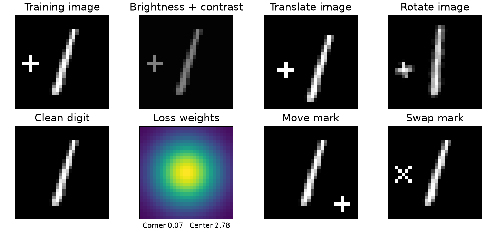

# What Does IDEC Preserve?

**John Zhang and Ryan Jian** · COSI 126A final project

We reproduced IDEC on MNIST at **88.10%** clustering accuracy (paper **88.06%**). Our project asks whether improving digit clustering also makes a model less sensitive to the background. We compare brightness/contrast jitter, whole-image rotation and translation with a Gaussian center weight in the reconstruction loss. Five matched seeds cover 12 training conditions, including clean training and testing without any geometric mark.

**Random translation** raised mean marked-digit accuracy from **67.51% to 80.63%** and reduced movement-induced cluster switches from **6.23% to 3.41%**. Gaussian center weighting alone reached **71.42%** accuracy and **5.19%** switches. All five paired seeds favored translation on both outcomes.

[Read the report](IDEC/report/report.pdf) · [View the slides](IDEC/slides/slides.pdf) · [Download the submission package](https://github.com/JohnR31N/cs126FinalProj/releases/download/idec-final-v1.6/IDEC_final.zip)

The [project README](IDEC/README.md) gives setup and reproduction commands. The [jitter protocol](IDEC/photometric/design.md), [spatial extension](IDEC/photometric/spatial_design.md), [results](IDEC/photometric/analysis/summary.csv) and [paired differences](IDEC/photometric/analysis/paired.json) document the complete comparison. The project also includes the earlier [targeted background augmentation](IDEC/background/design.md) and [additive stripe](IDEC/design.md) experiments.
